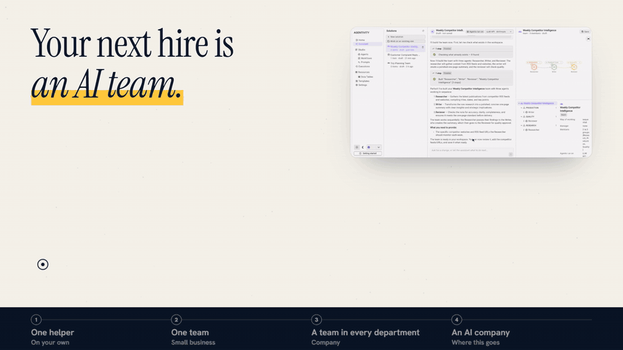
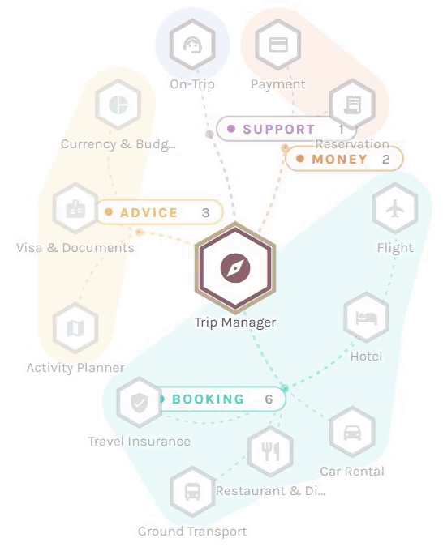
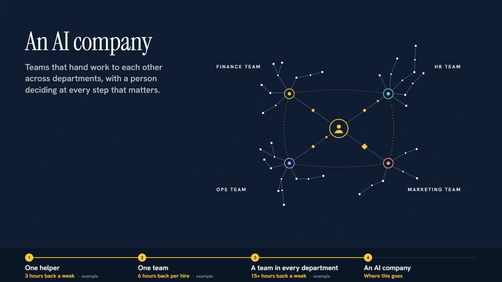
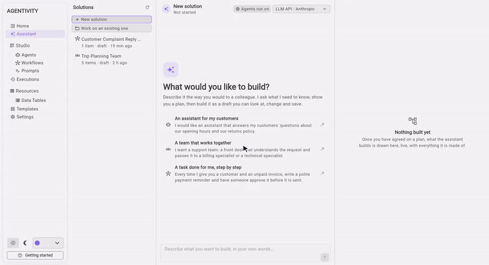
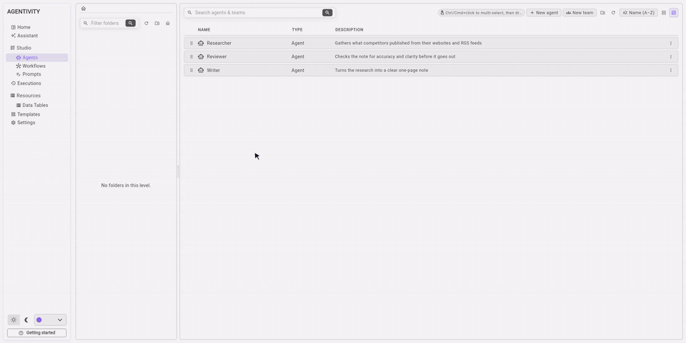
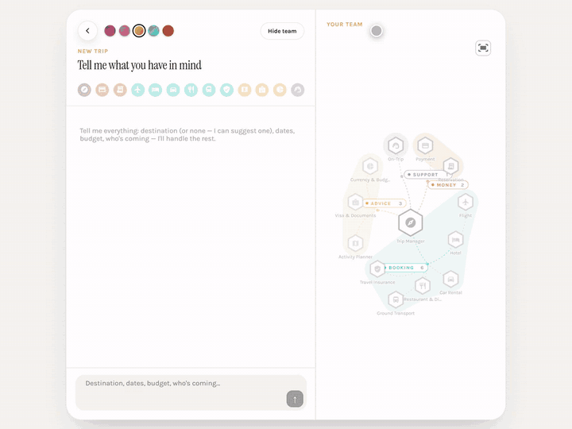
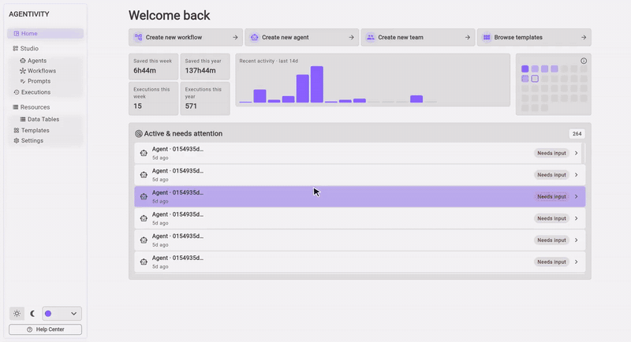
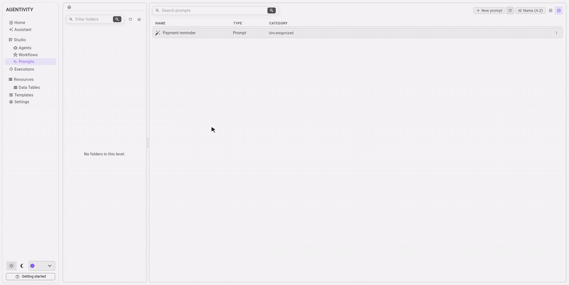
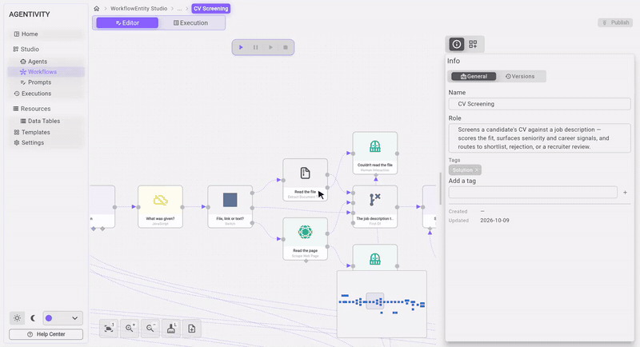

<p align="center">
  <a href="https://www.agentivity.io/?utm_source=github&utm_medium=readme&utm_campaign=repo">
    
  </a>
</p>

<h1 align="center">Agentivity</h1>

<p align="center"><strong>AI teams for your business, no code</strong></p>

<h3 align="center">Your next hire is an AI team.</h3>

<p align="center">
  Compose agents that collaborate, delegate and deliver, with the authority structure of a real team.
  You stay in charge. Your AI team does the work.
</p>

<p align="center">
  <strong><a href="https://www.agentivity.io/how-it-works?utm_source=github&utm_medium=readme&utm_campaign=repo">See how it works</a></strong> ·
  <a href="https://www.agentivity.io/community?utm_source=github&utm_medium=readme&utm_campaign=repo">Install the Community edition</a> ·
  <a href="https://www.agentivity.io/use-cases?utm_source=github&utm_medium=readme&utm_campaign=repo">Use cases</a> ·
  <a href="https://synergi.agentivity.io/?utm_source=github&utm_medium=readme&utm_campaign=repo">Ready-made Solutions</a> ·
  <a href="https://www.agentivity.io/docs?utm_source=github&utm_medium=readme&utm_campaign=repo">Documentation</a>
</p>

<p align="center">
  <a href="LICENSE"></a>
  <a href="https://www.agentivity.io/pricing?utm_source=github&utm_medium=readme&utm_campaign=repo"></a>
  
</p>

| **15+ hours back a week** | **No code** | **You stay in charge** | **Free forever** |
|---|---|---|---|
| The repetitive work, handed over | You brief a team like you brief a colleague | The team asks before anything important goes out | The Community edition costs nothing |

---

## A chatbot answers. A team gets the work done.

| With a chatbot, you do the managing | With a team, the work arrives finished |
|---|---|
| You ask, check, correct and ask again | Each specialist has a role and the tools for it |
| One generalist for every job | One checks the other's work |
| Nobody verifies the answer but you | You approve what matters |

**Organise them like a real team.** One after another. All at the same time. Passing the case to the right colleague.
Discussing in turns. Or a manager who plans and hands out the work. You choose when you create the team, and a team
can sit inside another team.

<p align="center">
  <a href="https://www.agentivity.io/how-it-works?utm_source=github&utm_medium=readme&utm_campaign=repo">
    
  </a>
  <br>
  <em>Led by a manager. A manager hands each part of the job to the right specialist. Here, a travel agency: one manager, twelve specialists.</em>
</p>

## Start with one helper. Grow to an AI company.

AI teams work next to your people. They take the repetitive work, your people keep the thinking and the decisions.

| | Example | Time back *(example)* |
|---|---|---|
| **1 · One helper**<br>*On your own* | Sam runs a bakery. A helper reads the order emails, answers the simple ones and keeps the list of what to bake. | 3 hours back a week |
| **2 · One team**<br>*Small business* | Marcus posts a job. A team of three writes the ad, compares each CV with the role and prepares the interviews. He meets the shortlist. | 6 hours back per hire |
| **3 · A team in every department**<br>*Company* | Finance, HR, Marketing and Ops each get an AI team next to their people. Sarah's team prepares the competitor briefing. She reviews it and sends it. | 15+ hours back a week |
| **4 · An AI company**<br>*Where this goes* | Teams that hand work to each other across departments, with a person deciding at every step that matters. | Teams inside teams work today. Running on a schedule comes with the cloud plans. |

<p align="center">
  
</p>

## Build your team

### Tell the Assistant what you need

Describe it the way you would to a colleague. The Assistant asks what it needs to know, shows you a plan, then builds a
draft you can look at, change and save. It is part of the Studio, in the Community edition.

<p align="center">
  <a href="https://www.agentivity.io/assistant?utm_source=github&utm_medium=readme&utm_campaign=repo">
    
  </a>
  <br>
  <em>One sentence, one question, one plan, then the team. Recorded from the product, played faster.</em>
</p>

| You can | For example | |
|---|---|---|
| **Create** | *"A team of three that prepares a weekly note on what our competitors published."* | From a sentence to a team, an agent or a workflow. |
| **Modify** | *"Add a translator at the end, who produces the French version of the approved note."* | Ask for a change. The draft updates. |
| **Challenge** | *"Challenge this team: what could go wrong, and what would you change?"* | Ask what is weak, before anything runs. |

Nothing is saved until you say so. And what it builds is an ordinary team you can open and adjust by hand.

### Or build it by hand in the Studio

| | |
|---|---|
| **Describe the role** | Give each agent a name, a job and the tools it needs. Like writing a job description. |
| **Build the team** | Drag your agents onto the canvas and choose how they work together. |
| **Hand over the work** | Ask in plain words. The team does the work and comes back to you for the decisions. |

<p align="center">
  <a href="https://www.agentivity.io/how-it-works?utm_source=github&utm_medium=readme&utm_campaign=repo">
    
  </a>
  <br>
  <em>Putting a team together in the Studio. Recorded from the product, played faster.</em>
</p>

**An agent**, **a team** or **a workflow**: you can use each one alone, or mix them.

## VibeApps: not fifty thousand screens. An app that adapts.

An app run by your team, for your colleagues or your customers.

> **Set the goal. The VibeApp handles the rest.**

| | |
|---|---|
| **Dynamic** | It adapts to the context. A classic app is static: everything is predefined. |
| **To the essential** | Not fifty thousand screens or settings. |
| **Human** | Much closer to a human interaction. |
| **It fits what you already have** | On its own, or inside the apps you already use. Agencies deliver it under their own brand. |

<p align="center">
  <a href="https://www.agentivity.io/use-cases/trip-planner?utm_source=github&utm_medium=readme&utm_campaign=repo">
    
  </a>
  <br>
  <em>An app built for one job. One sentence in. Flights, a hotel to choose, a dinner to book: each screen arrives when it is needed.</em>
</p>

You explain, it adapts: the right skills, at the right moment. Your need evolves, it moves forward with you.

**Or one portal for all your teams.** Publish a team and it appears in the portal, under your brand. No app to build.
To build your own VibeApp, use the SDKs described in [For developers](#for-developers).

## AI when you need judgment. Workflows when you need your own rules.

| | |
|---|---|
| **You decide. Your team executes.** | At any point you can step in, redirect, or approve before anything goes out. |
| **It backs your people. It does not replace them.** | The AI team takes the repetitive work. The judgment stays with the people who know the job. |
| **Every step is recorded** | Know what ran, when and why. |

A workflow is for the work that must follow the same steps every time. You draw it in the Studio from the Node Catalog,
which holds more than a hundred nodes: conditions and loops, data and code, AI agents and teams, the tools and the
knowledge you give them, web pages and documents, a person who approves, messages and storage. A team can use a
workflow, and a workflow can call a team. **[Every node, documented →](https://www.agentivity.io/docs/reference/nodes/?utm_source=github&utm_medium=readme&utm_campaign=repo)**

<p align="center">
  <a href="https://www.agentivity.io/how-it-works?utm_source=github&utm_medium=readme&utm_campaign=repo">
    
  </a>
  <br>
  <em>Drawing a workflow: a form, a team, a person who approves.</em>
</p>

## For AI engineers: the Prompt Studio

A prompt typed into a text box is a guess. You try it on one example, and a later change can break it without anyone
noticing. In the Prompt Studio, a prompt is something you measure, version and test.

| | |
|---|---|
| **Inputs** | Named variables, used in the prompt as `{{input_name}}`, each with a description and a default value. |
| **Versions** | Every version keeps its score, the tokens it used and its cost. |
| **Test cases** | Inputs and the expected answer, scored by an evaluation prompt. For each run: the model, the settings, the steps, the tokens and the cost. |
| **Analysis** | Scores per dimension, strengths, issues and recommendations, with an improved prompt you can apply. |
| **Optimization** | Several rounds that rewrite the prompt, the score of each round and the analysis of the failures, then the best candidate to apply. |
| **Response schema** | A JSON Schema that fixes the shape of the answer. |

Change a prompt, run its test cases, compare the score, and keep the new version only when it holds.

<p align="center">
  
  <br>
  <em>A one-line prompt, scored, optimized, scored again. Recorded from the product, the waits played faster.</em>
</p>

## See it running

Every example below is recorded from the product and explained step by step on agentivity.io.

| Example | What it does |
|---|---|
| **[Trip Planner](https://www.agentivity.io/use-cases/trip-planner?utm_source=github&utm_medium=readme&utm_campaign=repo)** | A manager and twelve specialists plan a trip. The traveller chooses the flights, the hotel and the dinner. |
| **[Shopping Lab](https://www.agentivity.io/use-cases/shopping-lab?utm_source=github&utm_medium=readme&utm_campaign=repo)** | Nine specialists read the stores' own pages, compare, score and write an illustrated report with its sources. |
| **[CV Screening](https://www.agentivity.io/use-cases/cv-screening?utm_source=github&utm_medium=readme&utm_campaign=repo)** | A workflow reads a CV and a job description, scores the fit, explains why, and sends the doubtful cases to a recruiter. |

<p align="center">
  <a href="https://www.agentivity.io/use-cases/cv-screening?utm_source=github&utm_medium=readme&utm_campaign=repo">
    
  </a>
</p>

Looking for a starting point? **[Synergi](https://synergi.agentivity.io/?utm_source=github&utm_medium=readme&utm_campaign=repo)**
lists ready-made Solutions. Each one is a complete use case in a single file, to import in the Studio.

## Get started

The **Community edition** is free forever and runs on your own machine or server, with the Studio included. It comes as
a Docker image.

```bash
docker run -d --name agentivity -p 5005:5005 -v agentivity-data:/app/_data agentivitylabs/agentivity
```

Then open `http://localhost:5005` in your browser: the Studio opens. You need Docker and, to run a team, an API key
from an AI model provider.

**[Full install guide →](https://www.agentivity.io/community?utm_source=github&utm_medium=readme&utm_campaign=repo)**

Not technical? Hosted plans are on the way, with nothing to install:
**[join the waitlist](https://www.agentivity.io/?utm_source=github&utm_medium=readme&utm_campaign=repo#cta)**.

| Edition | For |
|---|---|
| **Community** | Anyone comfortable with a server. Free forever. |
| **Personal** | One person: an independent, a shop owner, a freelancer. Hosted. *Coming soon.* |
| **Pro** | A professional who relies on it every day. Hosted. *Coming soon.* |
| **Business** | A team or a department, with shared workspaces. *Coming soon.* |
| **Enterprise** | An organisation with several teams and departments. On request. |

See the [editions and what you actually pay](https://www.agentivity.io/pricing?utm_source=github&utm_medium=readme&utm_campaign=repo).
You connect the AI model of your choice (OpenAI, Anthropic, Gemini, DeepSeek, xAI or AWS Bedrock) and pay that provider
directly. *These names are trademarks of their owners. No affiliation or endorsement.*

> **Good to know.** There is no login yet. Keep Agentivity on a network you trust, never directly on the internet.

## For developers

This repository holds the **engine**: it runs the workflows and AI steps, handles the human approvals and data tables,
and serves the HTTP API. Connect your own apps to it with the MIT-licensed SDKs for
[React](https://github.com/agentivity-labs/agentivity_sdk_react) and
[Flutter](https://github.com/agentivity-labs/agentivity_sdk_flutter): chat, approval forms, charts and themes, ready to
use. Build from source, the API reference and the guides are in the
[documentation](https://www.agentivity.io/docs?utm_source=github&utm_medium=readme&utm_campaign=repo).

The Studio, the AI teams and the ready-made examples are part of the Docker image, not of this repository. See
[LICENSING.md](LICENSING.md).

## Community

- **Ask a question or show what you built:** [Discussions](https://github.com/agentivity-labs/agentivity/discussions)
- **Report a bug or ask for a feature:** [open an issue](https://github.com/agentivity-labs/agentivity/issues)
- **Contribute:** see [CONTRIBUTING.md](CONTRIBUTING.md). A short contributor agreement applies.
- **Report a security problem:** see [SECURITY.md](SECURITY.md)
- **Code of conduct:** see [CODE_OF_CONDUCT.md](CODE_OF_CONDUCT.md)
- **Anything else:** hello@agentivity.io

## License

This repository is [fair-code](https://faircode.io) software, **source available** under the
[Elastic License 2.0](LICENSE). The Docker image carries its own terms.

- **Source available:** the code is always visible.
- **Self-hostable:** use it, modify it and run it on your own server for your company, free of charge. You may not
  offer it to others as a hosted service.
- **Extensible:** build on it with the SDKs (MIT) and the HTTP API.

Read the [License FAQ](LICENSE-FAQ.md) and [LICENSING.md](LICENSING.md). For a hosted-service, embedded or Enterprise
license, write to hello@agentivity.io. Copyright © 2026 SMART PIXEL BV. Third-party components and their licenses:
[THIRD-PARTY-NOTICES.md](THIRD-PARTY-NOTICES.md).

---

<p align="center">
  <em>Don't look for the solution. Build it.</em><br>
  <a href="https://www.agentivity.io/?utm_source=github&utm_medium=readme&utm_campaign=repo"><strong>agentivity.io</strong></a>
</p>
