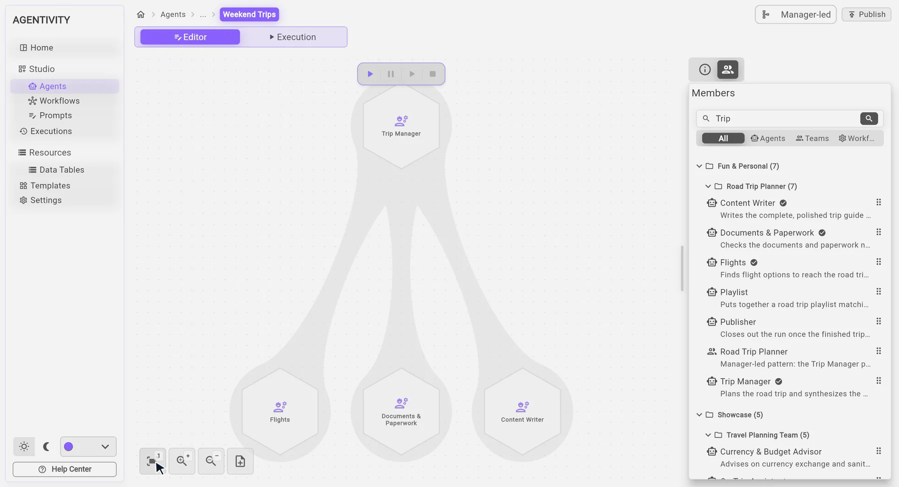

<!--
  Source of truth: README.md at the root of agentivity_service. The export copies it to the public repository
  (tools/export/export-manifest.json). The pictures are in docs/images (exported too, git-tracked files only).
  Same voice as agentivity.io: plain words, no code on this page (the code lives in the documentation), the platform first.
  Remove this comment before publishing.
-->

  

<h1 align="center">Agentivity</h1>

<h3 align="center">Your next hire is an AI team.</h3>

  Put AI specialists alongside your people. You brief them like colleagues, they take the repetitive work,
  and they ask you before anything important goes out. No code.

  <strong><a href="https://www.agentivity.io/how-it-works?utm_source=github&utm_medium=readme&utm_campaign=repo">See how it works</a></strong> ·
  <a href="https://www.agentivity.io/community?utm_source=github&utm_medium=readme&utm_campaign=repo">Install the Community edition</a> ·
  <a href="https://www.agentivity.io/use-cases?utm_source=github&utm_medium=readme&utm_campaign=repo">Use cases</a> ·
  <a href="https://synergi.agentivity.io/?utm_source=github&utm_medium=readme&utm_campaign=repo">Ready-made Solutions</a> ·
  <a href="https://www.agentivity.io/docs?utm_source=github&utm_medium=readme&utm_campaign=repo">Documentation</a>

  
  
  

---

## What you get

| | |
|---|---|
| **Hours back** | The repetitive and time-consuming work is handed over. The Studio counts the time your teams save. |
| **No code** | You describe a role in plain words, as you would for a new colleague, and you drag specialists into a team. |
| **You stay in charge** | The team stops and asks when a decision is yours, by email, on Slack, in a form or in your app. Every step is recorded. |
| **Yours** | Run it on your own server, with the AI models you choose. Your data stays with you. |

Agentivity backs your people. It does not replace them.

## Build a team in your browser

Everything happens in the **Studio**. Name an agent and describe its role. Put several in a team and choose how they
work together. Or draw a workflow when the steps must be the same every time.

  
   
  <em>Putting a team together in the Studio. Recorded from the product, played faster.</em>

**An agent**, **a team** or **a workflow**: you can use each one alone, or mix them. A team can use a workflow, and
a workflow can call a team.

  
   
  <em>Drawing a workflow: a form, a team, a person who approves.</em>

### Five ways to work together

One after another. All at the same time. Passing the case to the right colleague. Discussing in turns. Or a manager who
plans and hands out the work. You choose when you create the team, and you can change it later.

## Turn it into a VibeApp

A team does its work on a server. How people reach it is your choice: start it from the Studio, put it in the ready-made
portal, or build a **VibeApp**, an app with your team behind it.

> **Set the goal. The VibeApp handles the rest.**

  
   
  <em>Trip Planner, a VibeApp built with Agentivity. One sentence in, then a choice at every step that is the traveller's.</em>

## See real examples

Every example below is recorded from the product and explained step by step on agentivity.io.

| Example | What it does |
|---|---|
| **[Trip Planner](https://www.agentivity.io/use-cases/trip-planner?utm_source=github&utm_medium=readme&utm_campaign=repo)** | A manager and twelve specialists plan a trip. The traveller chooses the flights, the hotel and the dinner. |
| **[Shopping Lab](https://www.agentivity.io/use-cases/shopping-lab?utm_source=github&utm_medium=readme&utm_campaign=repo)** | Nine specialists read the stores' own pages, compare, score and write an illustrated report with its sources. |
| **[CV Screening](https://www.agentivity.io/use-cases/cv-screening?utm_source=github&utm_medium=readme&utm_campaign=repo)** | A workflow reads a CV and a job description, scores the fit, explains why, and sends the doubtful cases to a recruiter. |

  

Looking for a starting point? **[Synergi](https://synergi.agentivity.io/?utm_source=github&utm_medium=readme&utm_campaign=repo)**
lists ready-made Solutions. Each one is a complete use case in a single file, to import in the Studio.

## Get started

The **Community edition** is free forever and runs on your own machine or server, with the Studio included. It comes as
a Docker image.

**[Install the Community edition →](https://www.agentivity.io/community?utm_source=github&utm_medium=readme&utm_campaign=repo)**

Not technical? Hosted plans are on the way, with nothing to install:
**[join the waitlist](https://www.agentivity.io/?utm_source=github&utm_medium=readme&utm_campaign=repo#cta)**.

| Edition | For |
|---|---|
| **Community** | Anyone comfortable with a server. Free forever. |
| **Personal** | One person: an independent, a shop owner, a freelancer. Hosted. *Coming soon.* |
| **Pro** | A professional who relies on it every day. Hosted. *Coming soon.* |
| **Business** | A team or a department, with shared workspaces. *Coming soon.* |
| **Enterprise** | An organisation with several teams and departments. On request. |

See the [editions and what you actually pay](https://www.agentivity.io/pricing?utm_source=github&utm_medium=readme&utm_campaign=repo).
You connect the AI model of your choice (OpenAI, Anthropic, Gemini, DeepSeek, xAI or AWS Bedrock) and pay that provider
directly. *These names are trademarks of their owners. No affiliation or endorsement.*

> **Good to know.** There is no login yet. Keep Agentivity on a network you trust, never directly on the internet.

## For developers

This repository holds the **engine**: it runs the workflows and AI steps, handles the human approvals and data tables,
and serves the HTTP API. Connect your own apps to it with the MIT-licensed SDKs for
[React](https://github.com/agentivity-labs/agentivity_sdk_react) and
[Flutter](https://github.com/agentivity-labs/agentivity_sdk_flutter): chat, approval forms, charts and themes, ready to
use. Build from source, the API reference and the guides are in the
[documentation](https://www.agentivity.io/docs?utm_source=github&utm_medium=readme&utm_campaign=repo).

The Studio, the AI teams and the ready-made examples are part of the Docker image, not of this repository. See
[LICENSING.md](LICENSING.md).

## Community

- **Report a bug or ask for a feature:** [open an issue](https://github.com/agentivity-labs/agentivity/issues)
- **Contribute:** see [CONTRIBUTING.md](CONTRIBUTING.md). A short contributor agreement applies.
- **Report a security problem:** see [SECURITY.md](SECURITY.md)
- **Anything else:** hello@agentivity.io

## License

This repository is [fair-code](https://faircode.io) software, **source available** under the
[Elastic License 2.0](LICENSE). The Docker image carries its own terms.

- **Source available:** the code is always visible.
- **Self-hostable:** use it, modify it and run it on your own server for your company, free of charge. You may not
  offer it to others as a hosted service.
- **Extensible:** build on it with the SDKs (MIT) and the HTTP API.

Read the [License FAQ](LICENSE-FAQ.md) and [LICENSING.md](LICENSING.md). For a hosted-service, embedded or Enterprise
license, write to hello@agentivity.io. Copyright © 2026 SMART PIXEL BV. Third-party components and their licenses:
[THIRD-PARTY-NOTICES.md](THIRD-PARTY-NOTICES.md).

---

  <em>Don't look for the solution. Build it.</em> 
  <a href="https://www.agentivity.io/?utm_source=github&utm_medium=readme&utm_campaign=repo"><strong>agentivity.io</strong></a>

